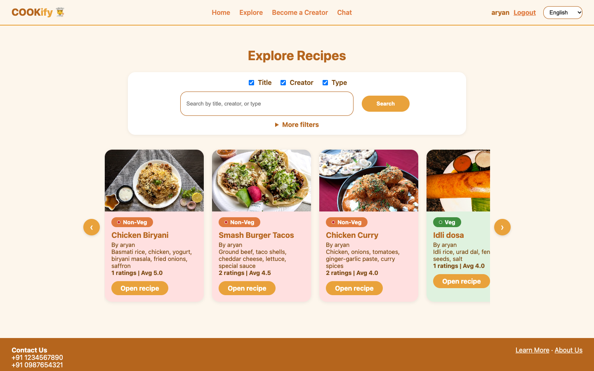
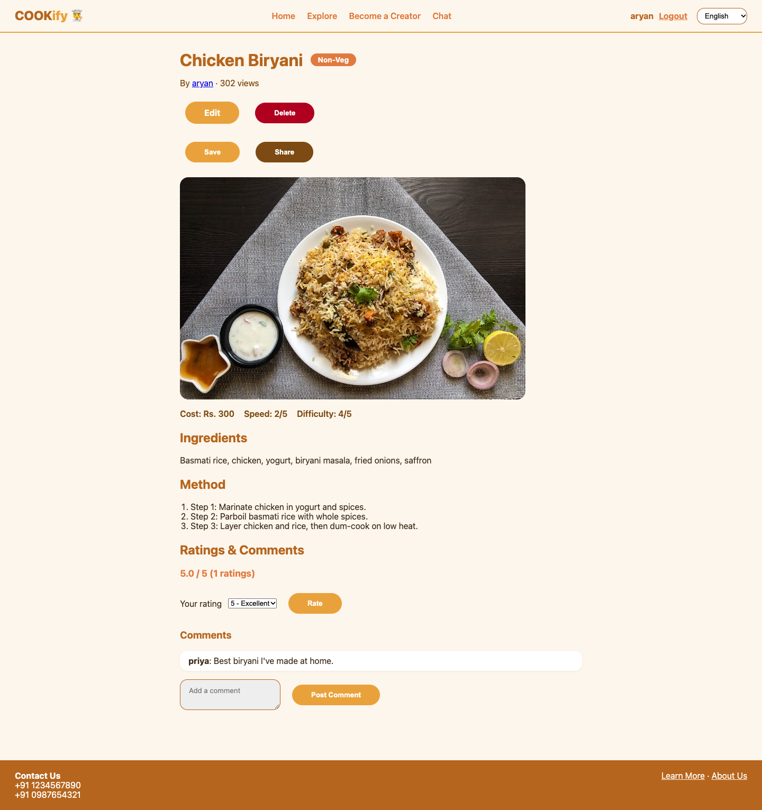
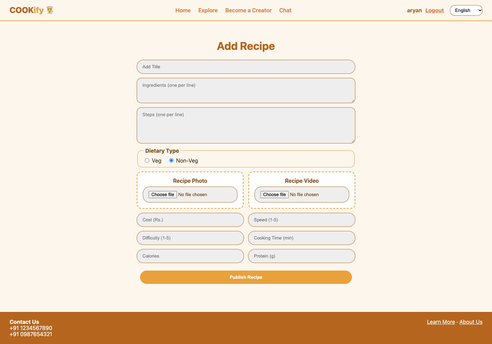
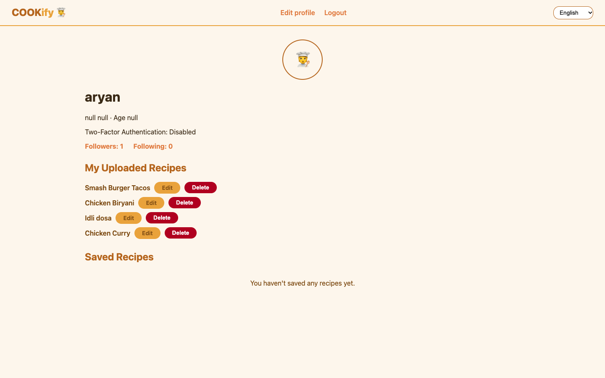
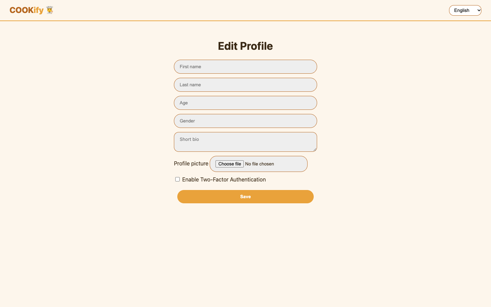
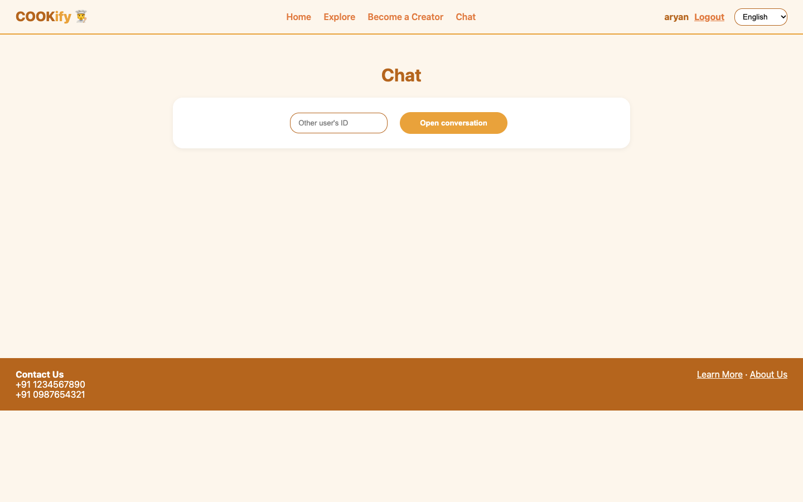
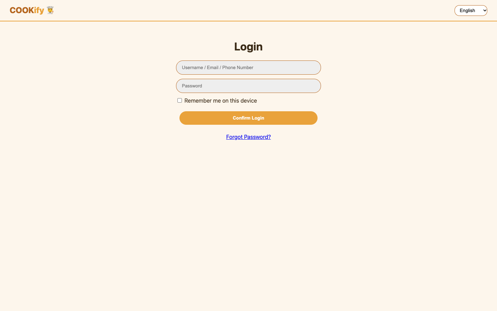
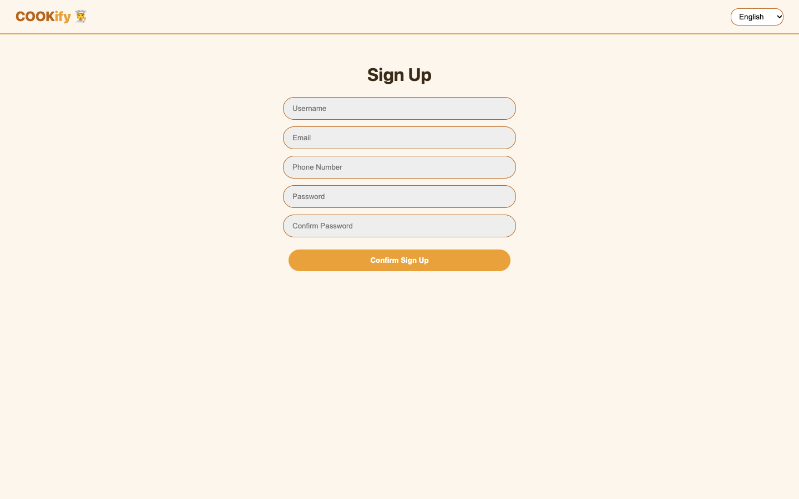
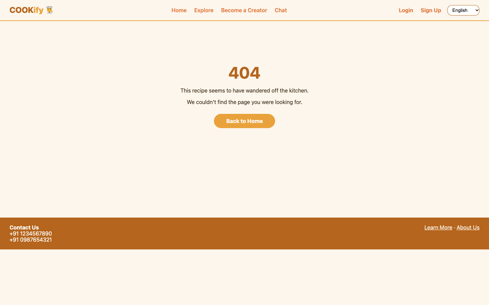

# COOKify

COOKify is a recipe-sharing community: creators upload recipes (text, photos, and video) with
cost/speed/difficulty and dietary (Veg / Non-Veg) attributes, everyone else searches and filters
them, rates and comments, follows their favorite creators, and chats with other users — all
behind account creation with email-based two-factor authentication. It's a Spring Boot +
Thymeleaf server-rendered app, built package-by-feature, with an OOP recipe hierarchy and a
defense-in-depth security layer.

This README covers the feature set, architecture, how to run it in one command, how to see the
2FA/subscription emails locally, how the 13 spec test cases map to automated tests, and a
summary of the security hardening in place.

## Features

**Accounts & authentication**
- Sign up (username/email/phone, password policy enforced server-side) and log in by username
  or email.
- Email one-time-password (OTP) two-factor authentication, enforced per-account
  (`user.two_factor_enabled`).
- "Remember me" persistent login — gated behind 2FA: the cookie is only issued *after* the OTP
  challenge succeeds, never before.
- Forgot-password flow via a second email OTP.

**Recipes**
- Create/edit/delete recipes with ingredients, method/steps, a photo and/or a video, plus
  cost, speed, and difficulty ratings.
- Recipes are modeled as an OOP hierarchy (`VegRecipe` / `NonVegRecipe` extend abstract
  `Recipe`) rather than a boolean flag, with a matching `RecipeCategory` row (veg flag, cooking
  time, calories, protein) alongside each recipe.
- Owner-only edit/delete, enforced server-side regardless of what the UI shows.

**Discovery**
- Explore page: multi-dimensional filtering (veg/non-veg, max cost, ingredient, min speed, min
  difficulty) plus sort by Most Popular / Newest / Top Rated.
- "Most Popular" is a weighted score over views, average rating, and recency — not just raw
  view count.
- Public creator profile pages, listing a creator's recipes and follower/following counts.

**Social**
- 5-star ratings (averaged per recipe) and free-text comments.
- Every comment is screened by a pluggable NSFW content filter before it's stored; a blocked
  comment is never persisted and the commenter gets an email warning instead.
- Follow ("subscribe") a creator: subscribing emails the creator, and every new recipe they post
  emails all of their subscribers.
- Save/bookmark any recipe to your profile.
- Built-in 1:1 chat between users (REST history + a STOMP/WebSocket live channel).

**Moderation & safety**
- 3-strike system: each NSFW violation raises a warning; the 3rd suspends the account and
  purges all of that user's recipes, ratings/comments, and subscriptions (both directions).

**Multilingual**
- Site-wide language switcher (English, Hindi, Mandarin, Russian, Spanish, French) via the
  Google Translate widget, present on every page through the shared layout.

**Profile**
- Edit profile (name, age, gender, bio, avatar), view your uploaded and saved recipes, and your
  follower/following counts.

## Tech stack

- **Java 21**, **Spring Boot 3.3.4** (Web MVC + Thymeleaf server-rendered views)
- **Spring Security** — form login, email-OTP 2FA, remember-me, CSRF, CSP
- **Spring Data JPA** + **Flyway** for schema migrations
- **H2** (in-memory) for dev/test; **PostgreSQL** for a prod-like run
- **Spring WebSocket (STOMP)** for 1:1 chat
- **Spring Mail** (`JavaMailSender`) for OTP codes and notification emails
- **JUnit 5**, **MockMvc**, **AssertJ**, **Mockito**, **GreenMail** (embedded SMTP for tests),
  **Awaitility** (async assertions)
- **Gradle 8.14.3** (wrapper included)

## Architecture

**Package-by-feature**, not package-by-layer: each business concern is a self-contained package
under `src/main/java/com/cookify/`, typically holding its own controller, service, entity, and
repository together:

```
com.cookify
├── auth/          signup, login support, password policy, remember-me
│   ├── otp/       email OTP issuance/verification + 2FA challenge controller
│   └── reset/     forgot/reset password
├── category/       RecipeCategory (veg flag, cooking time, calories, protein)
├── chat/          1:1 direct messages — REST history + STOMP live channel
├── comment/       comment storage + NSFW gate
├── config/        SecurityConfig, WebConfig, WebSocketConfig, AsyncConfig, DevDataSeeder
├── email/         EmailService (OTP + notification emails)
├── moderation/    ContentFilter (NSFW), ModerationService (3-strike ban + purge)
├── rating/        5-star ratings + averaging
├── recipe/        Recipe/VegRecipe/NonVegRecipe, RecipeService, RecipeController, ExploreController
├── saved/         bookmark a recipe to your profile
├── search/        RecipeFilter + RecipeSearchService (filtering, sorting) + specifications
├── storage/       upload validation + file storage
├── subscription/  follow a creator + new-recipe/new-subscriber email notifications
└── user/          User entity, profile controller
```

**Recipe OOP hierarchy.** `Recipe` is an abstract JPA entity (`@Inheritance(SINGLE_TABLE)`)
with two concrete subclasses, `VegRecipe` and `NonVegRecipe`, each overriding `dietaryLabel()`
and `type()`. `RecipeFactory.create(boolean veg)` is the single place that picks the subclass —
callers (the recipe form, the dev seeder) never branch on veg/non-veg themselves; they ask the
factory and get polymorphic behavior for free.

**Security layer** (see also the Security section below): `SecurityConfig` wires BCrypt
password hashing, a 2FA-aware remember-me implementation (`CookifyRememberMeServices`), CSRF
protection, and a strict Content-Security-Policy with no `'unsafe-inline'` — every page's JS is
externalized under `/js/**`. Recipe/profile ownership is enforced in the service layer
(`RecipeService.assertOwner`), not just hidden in the UI. STOMP chat subscriptions are
authorized per-destination (`ChatTopicAuthorization`) so a user can only subscribe to a
conversation they're actually part of.

## Running it (one command)

The default `application.yml` already points at an in-memory H2 database and a local SMTP host
(`localhost:1025`), so no external services are required to boot the app.

```bash
./gradlew bootRun
```

That's the one command: `bootRun` is configured (see `build.gradle`) to default the `dev`
Spring profile on, which does two things:
1. Uses the bundled H2 datasource (same as the default — nothing to configure).
2. Activates `DevDataSeeder`, which seeds a creator user (`aryan`) plus two more users, the four
   sample recipes, a few ratings, and one subscription — **only if the database is empty** (it's
   idempotent, so restarting never duplicates data or clobbers a real signup).

Then open:
- `http://localhost:8080/` — landing page
- `http://localhost:8080/explore` — populated recipe grid
- `http://localhost:8080/login` — log in as a seeded user (see credentials below)

**Demo login:** username `aryan` (or `priya` / `rahul`), password `Cookify-Demo123`. These
seeded users have 2FA switched off, so login goes straight through.

**To opt out of the dev profile** (e.g. to see first-boot/empty-state behavior), override with
command-line args, which outrank the system property `bootRun` sets by default:
```bash
./gradlew bootRun --args='--spring.profiles.active=prod'
```
(a plain `SPRING_PROFILES_ACTIVE=...` environment variable will **not** override it on its own —
Spring ranks Java system properties above OS environment variables).

### Optional: PostgreSQL + MailHog via Docker Compose

A `docker-compose.yml` is included for a more production-like local run:

```bash
docker compose up -d      # starts Postgres on :5432 and MailHog on :1025 (SMTP) / :8025 (UI)
./gradlew bootRun --args='--spring.profiles.active=prod,dev'
```

`prod` switches the datasource to that Postgres instance (Flyway runs the same migrations
against it) and the mail host to MailHog; adding `dev` on top still activates the seeder, so you
get a populated, Postgres-backed instance with real emails visible in MailHog. Use `prod` alone
to start from an empty database. Postgres credentials/DB name are `cookify` / `cookify` / `cookify`
(see `docker-compose.yml` / `application-prod.yml`); override with the `DB_URL` / `DB_USER` /
`DB_PASSWORD` / `MAIL_HOST` / `MAIL_PORT` environment variables if needed.

### Seeing the 2FA code (and other emails)

The app sends real email via `JavaMailSender` — it doesn't log OTP codes to the console. To see
them locally:
1. `docker compose up -d` (starts MailHog).
2. Sign up a new user or enable 2FA, then log in — the OTP email is sent to `localhost:1025`.
3. Open **http://localhost:8025** (MailHog's web UI) and read the code straight out of the
   email body.

The same MailHog inbox also shows "new subscriber" / "new recipe from a creator you follow" /
password-reset / NSFW-warning emails.

If you don't want to run MailHog, the demo users (`aryan`/`priya`/`rahul`) all have 2FA switched
off, so you can explore the whole app without ever needing to read an OTP email.

## Testing

```bash
./gradlew test --offline
```

Every one of the **13 spec test cases** (account creation, login+2FA+session, recipe storage,
search filters, veg/non-veg toggle, popularity sorting, UX/aesthetics, NSFW comment + email
warning, rating averaging, code modularity, 3-strike ban + purge, multilingual, subscription +
email) traces to at least one real, passing automated test. The full case-by-case mapping —
including which test method covers which case, and the deeper supporting tests for each — is in
**[`docs/TEST-TRACEABILITY.md`](docs/TEST-TRACEABILITY.md)**.

`src/test/java/com/cookify/acceptance/AcceptanceTraceabilityTest.java` is the canonical,
numbered entry point (one method per case); run just that suite with:

```bash
./gradlew test --offline --tests "com.cookify.acceptance.AcceptanceTraceabilityTest"
```

## Database

Full schema, table-by-table definitions, an ER diagram, indexes/constraints, and design notes are
in **[`docs/DATABASE.md`](docs/DATABASE.md)**. The schema is Flyway-managed
(`src/main/resources/db/migration/`, `V1`–`V5`) and validated on startup (`ddl-auto: validate`).

## Security

- **Password hashing** — BCrypt (`BCryptPasswordEncoder`), never plaintext, never reversible.
- **Email-OTP two-factor authentication** — a 6-digit, 10-minute-expiry, hashed-at-rest OTP sent
  by email; verification is rate-limited (max attempts) and consumed on success.
- **Remember-me gated by 2FA** — the persistent-login cookie is never issued before the OTP
  challenge completes; a premature login never leaves a usable token behind, and other devices'
  tokens are untouched by a fresh login attempt.
- **CSRF protection** — enabled by default (Spring Security), required on every state-changing
  form post.
- **Strict Content-Security-Policy** — `script-src` has no `'unsafe-inline'`; every page's
  JavaScript is externalized to a same-origin file under `/js/**` (verified by
  `CspScriptExternalizationTest`). The policy is deliberately widened only for the Google
  Translate widget's specific hosts.
- **NSFW content filter** — every comment is screened before storage; a rejected comment is
  never written to the database.
- **3-strike ban + content purge** — a 3rd moderation warning suspends the account and deletes
  all of that user's recipes (and their categories/ratings), their own ratings/comments on other
  recipes, and their subscriptions in both directions.
- **Owner checks in the service layer** — recipe edit/delete/update verifies
  `recipe.recipeCreatorId == actingUserId` in `RecipeService`, not just in the UI, so a crafted
  request from a non-owner is rejected (`403`) before any file is even written to disk.
- **Upload hardening** — `FileStorageService` validates the declared content type, rejects empty
  files, and sniffs image bytes (an `image/png`-labelled file with bogus bytes is rejected, not
  trusted on label alone).
- **STOMP subscription authorization** — a chat WebSocket client may only subscribe to a
  conversation topic (`/topic/chat.{idA}-{idB}`) they're actually a participant in
  (`ChatTopicAuthorization`), enforced in the inbound channel interceptor, not just client-side.

## Screenshots

Captured from the running app (`./gradlew bootRun`, `dev` profile — H2 + seed data), logged in as a
demo user. All images are under [`docs/screenshots/`](docs/screenshots/).

### Explore — search, Title/Creator/Type filters, color-coded recipe cards


### Recipe detail — photo/video, ratings, comments, subscribe, owner-only Edit/Delete


### Create a recipe (Become a Creator)


### Profile and the 2FA toggle



### Chat · Login · Sign up · friendly 404





Seeded recipe photos are credited in [`ATTRIBUTIONS.md`](ATTRIBUTIONS.md).

To reproduce: `./gradlew bootRun`, open `http://localhost:8080/`, and log in with a seeded user
(see the **Run** section above).
